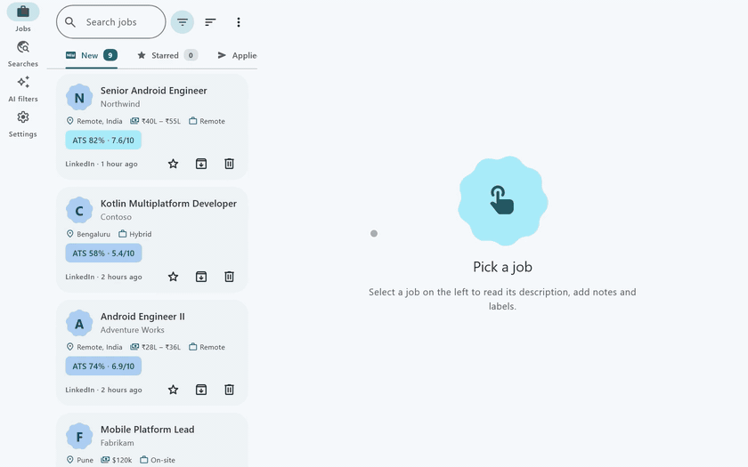
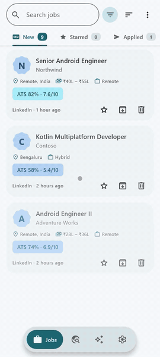

# JobFinder

Get new jobs from LinkedIn, Indeed, Glassdoor and other boards the moment they're posted, filtered
and scored against your resume by a local AI. Runs on your Windows computer, with an Android app
for your phone. No account, no server: your data stays with you.

  
  

▶ [Desktop tour](docs/video/desktop.mp4) · [Phone tour](docs/video/phone.mp4) ·
[Screenshots](docs/screenshots/README.md)

## Features

- New jobs from your saved searches on any job board
- AI filter in plain words ("no Java, remote only")
- ATS resume score, per-job resume edits and resume PDFs
- Company ratings, pay and ghost-job check
- Form answers saved and filled by the [browser extension](browser-extension/README.md)
- Free AI only: local model, or free online keys
- MCP for AI agents (Claude Code, Gemini CLI, Codex, Cursor)
- Locked daily backups

## Install

From [Releases](../../releases): `.msi` for Windows 10/11, `.deb` for Linux (preview), `.apk` for
Android 8+. Then follow [Get started](docs/guides/getting-started.md).

## Learn more

- Guides: [searches](docs/guides/job-searches.md) · [AI filter](docs/guides/ai-filter.md) ·
  [resume and ATS](docs/guides/resume-and-ats.md) · [free AI](docs/guides/free-ai.md) ·
  [AI agents](docs/guides/ai-agents.md) · [phone](docs/guides/phone.md) ·
  [extension](docs/guides/browser-extension.md) · [backups](docs/guides/backups.md)
- [Privacy](PRIVACY.md) · [Building and contributing](CONTRIBUTING.md) · [Credits](CREDITS.md)
